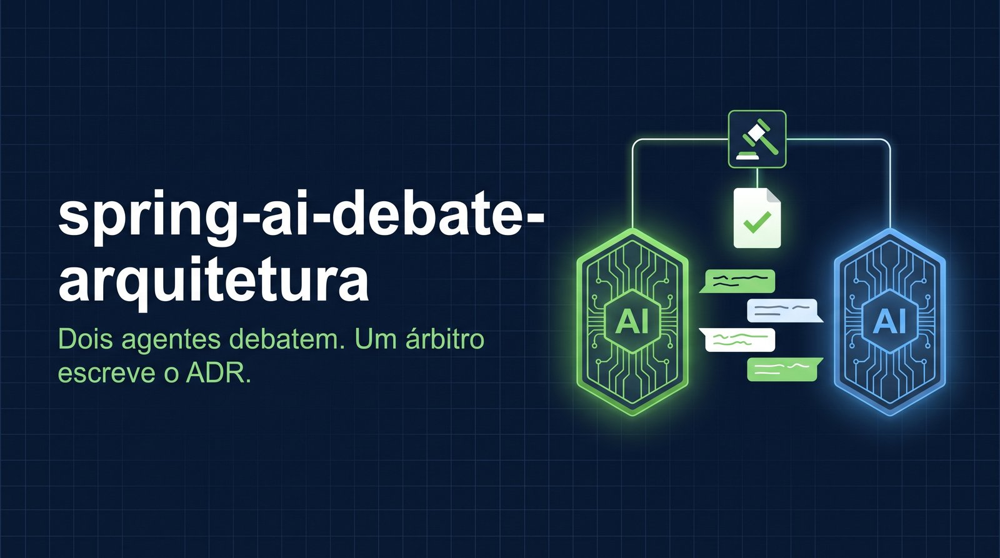
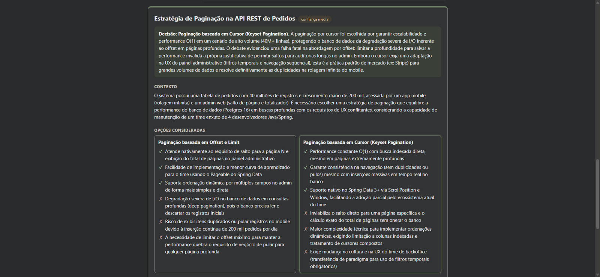
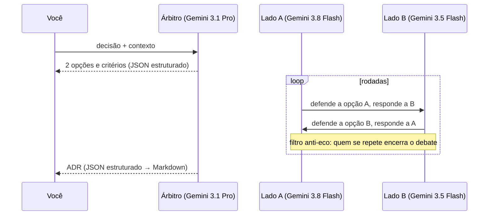

# spring-ai-debate-arquitetura



[](https://github.com/ronnyarruda20/spring-ai-debate-arquitetura/actions/workflows/ci.yml)


Você descreve uma decisão de arquitetura e o contexto do seu time. **Dois agentes de IA debatem**, cada um defendendo uma opção e respondendo ao argumento do outro. Depois, **um árbitro** lê o debate e escreve um **ADR** (Architecture Decision Record) pronto para ir para o repositório: opções com prós e contras, decisão, justificativa, consequências e quando revisitar.

A ideia é evitar o viés de pedir uma resposta só: o modelo sozinho tende a concordar com a pergunta. Com dois lados obrigados a se contestar, os pontos fracos de cada opção aparecem antes da decisão.



## Exemplo real

[`exemplos/debate-paginacao.md`](exemplos/debate-paginacao.md) tem um debate completo, sem edição, sobre **paginação offset × cursor** numa tabela de 40 milhões de pedidos. Os dois lados citaram detalhes concretos, como o custo do `OFFSET` profundo no Postgres, o `Window` e o `ScrollPosition` do Spring Data e o *deferred join*. O árbitro escolheu cursor, mas registrou o custo para o painel administrativo e quando revisitar.

## Como funciona



## Decisões de implementação

- **Um modelo por papel.** O árbitro usa o modelo mais forte; os advogados usam modelos diferentes entre si, para o debate não ser a mesma voz discutindo consigo mesma. No Spring AI 2 isso é um `ChatClient` por papel, com as opções do provedor trocando só o modelo. Ver [`DebateConfig`](backend/src/main/java/io/github/ronnyarruda20/debate/config/DebateConfig.java).
- **Saída estruturada onde importa.** O enquadramento e o ADR voltam como JSON validado contra records Java; as falas do debate são texto livre, porque ali a forma não importa.
- **Filtro anti-eco.** Se um lado começa a repetir o que já disse, medido pela similaridade de Jaccard entre as falas, o debate para e vai direto ao árbitro, sem gastar mais chamadas. A ideia veio de um projeto meu anterior, de GPT conversando com GPT, em que o filtro encerrava a conversa quando os dois entravam em eco. Ver [`FiltroAntiEco`](backend/src/main/java/io/github/ronnyarruda20/debate/dominio/FiltroAntiEco.java).
- **Advogados que admitem fraquezas.** As instruções pedem que cada lado responda ao argumento mais recente do outro e reconheça os pontos fracos da própria opção, dizendo como mitigá-los. Isso rende um debate útil em vez de dois monólogos.
- **Confiança explícita.** Se o contexto não basta para decidir, o árbitro decide mesmo assim, marca confiança baixa e diz que informação mudaria a decisão.
- **Custo previsível.** Cada debate faz 2 + 2 × rodadas chamadas, com teto de rodadas no servidor. Duas rodadas levam cerca de um minuto.

## Como rodar

Requer Docker e uma chave da API do Gemini ([Google AI Studio](https://aistudio.google.com/apikey)).

```bash
export GEMINI_API_KEY=sua-chave
docker compose up --build
```

Abra <http://localhost:8080>, escolha um dos exemplos ou descreva a sua decisão, e clique em **Começar debate**. O ADR pode ser baixado em Markdown.

| Variável | Padrão | Para quê |
|---|---|---|
| `MODELO_ARBITRO` | `gemini-3.1-pro-preview` | Enquadra e escreve o ADR. |
| `MODELO_A` | `gemini-3.8-flash` | Defende a primeira opção. |
| `MODELO_B` | `gemini-3.5-flash` | Defende a segunda. |
| `CHAT_PROVIDER` | `google-genai` | `anthropic` para usar Claude; defina então os três modelos, por exemplo `claude-opus-5`, e `ANTHROPIC_API_KEY`. |

**Pela API** (Server-Sent Events):

```bash
curl -N -X POST localhost:8080/api/debates -H 'Content-Type: application/json' \
  -d '{"pergunta":"RabbitMQ ou Kafka para eventos de pedidos?","contexto":"5 mil eventos por minuto, time pequeno","rodadas":2}'
```

### Desenvolvimento

```bash
cd backend && mvn spring-boot:run              # API em :8080 (Java 21)
cd frontend && npm install && npx ng serve     # interface em :4200, com proxy para a API
```

## Testes

```bash
cd backend && mvn verify          # 16 testes
cd frontend && npx ng test        # 7 testes
```

Um modelo falso reconhece o papel pelas instruções (árbitro enquadrando, lado A, lado B, árbitro decidindo) e responde de acordo. Assim os testes conferem a ordem dos turnos, o modelo usado por cada papel, que cada lado recebe a fala do outro, que o árbitro recebe o debate inteiro, o filtro anti-eco encerrando cedo e o teto de rodadas, sem chamar API paga.

## Limitações

- O ADR é um rascunho: a decisão depende do contexto que você dá, e o árbitro também é um modelo.
- Os dois lados vêm da mesma família de modelos. Com as chaves de dois provedores, dá para pôr Gemini contra Claude trocando os modelos por papel.

## Stack

Java 21 · Spring Boot 4.0 · Spring AI 2.0 (`ChatClient` por papel, saída estruturada) · Gemini e Claude · Angular 21 · Vitest · GitHub Actions · Docker

## Licença

[MIT](LICENSE)
